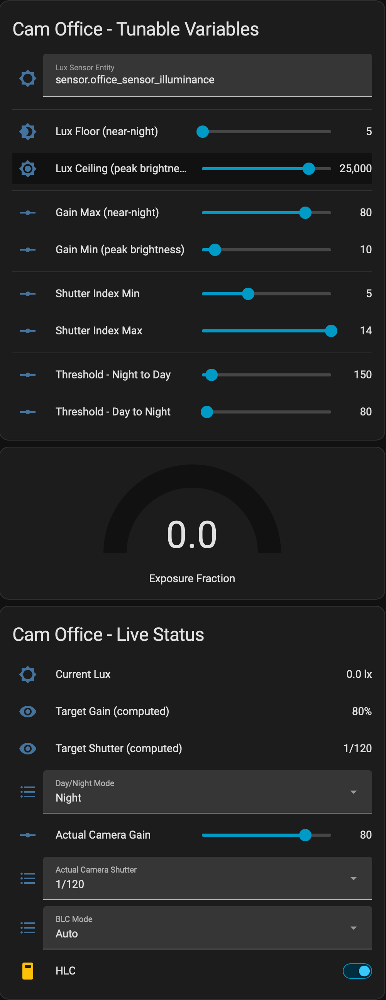

# Lux-Driven Camera Exposure Automation

A Home Assistant package that automatically adjusts a fixed-iris IP camera's
exposure (gain, shutter speed) and image-processing settings (HLC, BLC, noise
reduction, etc.) in real time based on ambient light, and switches the camera
between Day (color) and Night (B&W) modes with proper hysteresis to avoid
flapping at dusk/dawn or during passing clouds.

It was built for Hikvision cameras using a local lux/illuminance sensor. Using
the interactive setup script (`create-camera-yaml-config.py`), you can easily
generate customized configuration files for any camera without editing personal
identifiers or manual entity mappings directly in the YAML templates.

## Why this exists

With a fixed iris, gain and shutter speed are the only two exposure controls
available. Rather than a handful of hardcoded "profiles," this automation
computes both continuously from the current lux reading using a log-scale
curve (light perception/exposure is roughly logarithmic, so this avoids
collapsing most of the useful range into a tiny sliver of the lux scale).
Everything else (HLC level, BLC mode, brightness/contrast/saturation/
sharpness/noise reduction) switches as a simple Day/Night pair, since those
don't need to track lux continuously the way exposure does.

## What it does

1. **Continuous exposure** - every minute, computes a normalized "how bright
   is it" fraction from the current lux reading and maps it onto:
   - **Gain** (0-100): high at night, low in bright light.
   - **Shutter speed**: snapped to the nearest of the camera's real shutter
     steps, slow at night, fast at peak brightness.
     Values are only written to the camera when they actually change, so it
     doesn't spam the device with redundant commands.

2. **Day/Night mode switching** - flips the camera's Day/Night mode (plus
   the non-exposure image settings) when lux crosses a threshold and *stays*
   there for a sustained period. Two different thresholds are used (higher
   to go Night→Day, lower to go Day→Night) so a brief cloud or sunbeam
   doesn't cause flapping.

3. Respects the camera integration's mutually-exclusive feature rules
   (enabling WDR auto-disables HLC/BLC and vice versa) by explicitly
   sequencing the relevant calls with short delays rather than firing them
   all at once.

## Files

| File | Purpose |
|---|---|
| `create-camera-yaml-config.py` | Interactive setup script that generates customized YAML files for your specific camera. |
| `hikvision_lux_automation.yaml` | The package template: helpers, template sensors, and automations. |
| `hikvision_lux_automation_dashboard_card.yaml` | Lovelace card template exposing all tunable variables and live status in one place. |

## Prerequisites

- Home Assistant `configuration.yaml`: include **packages** in `homeassistant` section
  ```yaml
  homeassistant:
    packages: !include_dir_named packages
  ```
- A lux/illuminance sensor entity.
- **[Hikvision ISAPI Image Control](https://github.com/JoshADC/hikvision_isapi)** installed via HACS - this is what exposes the camera's gain, shutter speed, HLC, BLC, WDR, day/night mode, etc. as native `number`/`select`/`switch` entities that this automation reads and writes. It's not in the default HACS store, so add it as a custom repository:
  1. HACS → three-dot menu (top right) → **Custom repositories**
  2. Add `https://github.com/JoshADC/hikvision_isapi`, category **Integration**
  3. Install, then restart Home Assistant
  4. **Settings → Devices & Services → Add Integration** → search **Hikvision ISAPI Image Control** → enter your camera's IP or hostname with the admin credentials
  5. Entities are auto-discovered based on your camera's capabilities, so the exact set (and the shutter speed list) can vary by model/firmware - confirm yours matches what's assumed in `[camera_name]_hikvision_lux_automation.yaml` before deploying (see **Configuration** below).

  IMPORTANT: You can't use the camera's own internal scene-switching/scheduling day/night at the same time as this integration - this whole project exists to replace that with something lux-driven instead.
- If reusing this for a camera not covered by that integration: any integration exposing equivalent `number`/`select`/`switch` entities for gain, shutter speed, HLC, BLC, day/night mode, etc. will work, but entity IDs and available options will need adapting throughout.

## Installation & Setup

### Step 1: Generate Your Camera-Specific Files
Run the interactive setup script on your machine to configure the templates for your specific camera:
```bash
python create-camera-yaml-config.py
```
The script will prompt you for your camera's friendly name, entity ID prefix, and lux sensor entity ID, generating your custom automation and dashboard card yaml files.

### Step 2: Deploy to Home Assistant
1. Copy the generated automation package file (`[camera_name]_hikvision_lux_automation.yaml`) to your Home Assistant packages directory: `/config/packages/`.
2. Confirm the `packages` line above is in `configuration.yaml`.
3. **Restart Home Assistant** (required the first time a brand-new package file is added)
4. Verify in **Developer Tools → States**: search your camera prefix and confirm the helpers and template sensors show real values, not `unknown`/`unavailable`.
5. Add the dashboard card: Open your Lovelace dashboard, click **Edit Dashboard → Add Card → Manual**, and paste the contents of your generated `[camera_name]_hikvision_lux_automation_dashboard_card.yaml` file.

## Dashboard Card



The card has three sections:

**Tunable Variables** - the `input_number`/`input_text` helpers that shape
the exposure curve and day/night thresholds. **Editing these here is always
safe and never gets overwritten** - the automations only *read* these
values, they never write to them. When a change actually reaches the
camera differs by which helper you touch:

- **Exposure helpers** (`lux_floor`, `lux_ceiling`, `gain_max`, `gain_min`,
  `shutter_idx_min`, `shutter_idx_max`): picked up automatically within
  about a minute. The exposure sensors recompute every 60 seconds
  regardless of what triggered them, so a change just takes effect on the
  next tick.
- **Day/Night thresholds** (`lux_night_to_day`, `lux_day_to_night`): more
  subtle, because the trigger's lux lookup is indirect (through the
  `input_text` sensor helper), Home Assistant can't statically determine
  what to watch and falls back to re-evaluating on every state change
  system-wide - which does include these helpers changing. But the
  `for: 00:05:00` sustain still applies on top of that:
  - If your change doesn't flip the true/false result (lux was already
    past both the old and new threshold), nothing resets - it keeps
    counting toward whatever crossing it already detected.
  - If your change *does* flip the result (e.g. lowering the day-to-night
    threshold below current lux), that counts as a fresh transition and
    the 10-minute countdown **restarts from that moment** - it won't apply
    instantly. This is correct behavior for normal operation (it's what
    prevents flapping), but can be surprising while actively tuning and
    expecting an immediate result.
- Neither the reload nor startup event triggers fire from a helper value
  changing - those only fire on an actual automation reload or HA restart.

If you want an instant push while tuning - bypassing the minute-tick wait
or the 10-minute sustain - that would take a dedicated "force recheck now"
helper (e.g. an `input_button` both automations also trigger on); not
included here since it's a tuning convenience rather than something the
automation needs, but straightforward to add if useful.

**Exposure Fraction gauge** - a read-only visual of the current normalized
brightness value (0 = your configured "floor" lux, 1 = your configured
"ceiling"). Not editable; it's a computed `sensor`, so there's nothing to
overwrite here either way.

**Live Status** - this section is a mix, and behaves differently depending
on the row:

| Row | If you change it manually |
|---|---|
| Current Lux | Read-only sensor - can't be edited here regardless. |
| Target Gain / Target Shutter (computed) | Read-only sensors - reflect what the formula wants, not editable. |
| **Actual Camera Gain** | Editable, but the exposure automation re-checks every minute and will **overwrite it back** to the computed target within about 60 seconds if it differs. |
| **Actual Camera Shutter** | Same as above - **overwritten within about a minute** if it drifts from the computed target. |
| Day/Night Mode | Editable, and **not touched by the per-minute exposure automation**. It only gets changed by the Day/Night Switch automation, which only fires on a sustained threshold crossing - so a manual change here can persist for hours until the next real dusk/dawn transition (or indefinitely, if lux never crosses back the other way). |
| BLC Mode / HLC | Same as Day/Night Mode - only touched by the Day/Night Switch automation, so manual changes stick until the next mode flip. |

So in short: anything under **Tunable Variables** is a permanent, safe
override. Anything under **Live Status** that's also part of the *exposure*
loop (gain, shutter) will drift back within a minute. Anything under
**Live Status** that's part of the *day/night* loop (mode, BLC, HLC) will
stick until the next real transition - useful for testing a manual
override for a while, but don't forget it's not "sticky forever."

## Configuration - what to edit for your setup

### Required: your camera's entity IDs & options

When running `create-camera-yaml-config.py`, the script automatically replaces the template placeholders with your camera's specific entity ID prefix. Also check:

- Your shutter speed `select` entity's actual list of options - the
  index-mapping logic assumes a specific ordered list of values
  (`1/3` through `1/100000`). Update the `shutter_options` list in the
  template if your camera model differs.
- Your camera's actual feature-exclusivity rules, if any - the Day/Night
  switch automation sequences BLC/HLC changes with short delays assuming
  this camera's specific WDR/HLC/BLC exclusivity behavior.
- The specific numeric values used in the Day/Night switch automation's
  "apply this image profile" steps (brightness, contrast, saturation, etc.)
  - these will need re-tuning for any other camera environment.

### No YAML editing needed: the lux sensor

The lux sensor is *not* hardcoded - it's resolved at runtime through
your configured text helper value. To point this at a different
sensor, just change that helper's value (Settings → Devices & Services
→ Helpers, or the dashboard card) to the new entity_id. No reload needed.

### Tunable variables (all live-adjustable via Helpers or the dashboard card, no YAML/reload needed)

| Helper | Meaning |
|---|---|
| `..._lux_floor` | Lux treated as "fully dark" (bottom of the exposure curve) |
| `..._lux_ceiling` | Lux treated as "fully bright" (top of the exposure curve) |
| `..._gain_max` / `..._gain_min` | Camera gain at the floor/ceiling of the curve |
| `..._shutter_idx_min` / `..._shutter_idx_max` | Index into the shutter options list at floor/ceiling (0 = slowest, 14 = fastest) |
| `..._lux_night_to_day` | Lux threshold to switch Night → Day (higher, to resist flapping) |
| `..._lux_day_to_night` | Lux threshold to switch Day → Night (lower) |
| `..._lux_sensor_entity_id` | Entity ID of the lux sensor to read |

Both Day/Night thresholds require the crossing to hold for **10 minutes**
before switching (hardcoded in the automation's `for:` - not a dashboard
value, since it's an automation-structure choice rather than a per-install
tuning knob).

## Troubleshooting

- **A helper/sensor shows `unavailable`**: check Settings → System → Logs
  for a template rendering error on that entity - a common cause is a type
  mismatch (e.g. using a float where a list index needs an int).
- **An automation entity gets a `_2` suffix after an edit**: this happens
  if the automation's internal `id:` field changes - Home Assistant treats
  that as a brand-new automation rather than an update to the existing one,
  leaving an orphaned duplicate behind. Check Settings → Devices & Services
  → Entities to find and delete the orphan, then do a full restart to reconcile.
- **Automation editor shows "unknown entity"**: for `template:` sensors,
  the actual entity_id is derived from the `name:` field, *not* from
  `unique_id`. If you renamed `unique_id` without also renaming `name:`,
  references elsewhere will point at an entity_id that was never created.
- **Day/Night mode never switches even though lux clearly crosses the
  threshold**: check an automation trace for a `state` condition that
  always evaluates `false`. Some integrations report a `select` entity's
  actual state in a different case than what's shown in the UI dropdown.
- **Day/Night automation shows "last triggered" hours/days ago and never
  fires**: `template` triggers with `for:` only fire on a false→true
  transition they actually witness. This automation re-checks the
  real-time state directly whenever automations get reloaded and whenever
  HA finishes starting up so it self-corrects right after either event.
- **Checking what actually happened**: Settings → Automations & Scenes →
  open an automation → Traces tab shows exactly which trigger fired, which
  conditions passed/failed, and the rendered value of every action step.

## Known limitations

- HLC level, BLC mode, and the brightness/contrast/saturation/sharpness/
  noise-reduction numbers are a simple Day/Night binary, not lux-continuous
  - they were only tuned from two known-good snapshots (one day, one
  night), not a full curve.
- The dusk/dawn "twilight zone" (roughly 60-150 lux) is an inherent
  compromise: too bright for clean B&W night mode, too dim for clean color
  daytime video. Expect some tuning iteration here - trade-offs between
  noise (needs slower shutter/lower gain) and motion blur (needs faster
  shutter) don't have a single objectively-correct answer.
